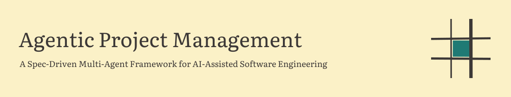

<picture>
  <source media="(prefers-color-scheme: dark)" srcset="assets/readme-header-dark.svg"/>
  
</picture>

[](https://opensource.org/licenses/MPL-2.0) [](https://www.npmjs.com/package/agentic-pm) [](https://github.com/sdi2200262/agentic-project-management/releases)

APM is an open-source framework for managing ambitious software projects with AI assistants. On long tasks, the LLM behind your agent suffers from context decay and context pressure as its conversation grows. APM counters the first by recording the project's intent in planning documents, and the second by splitting the work among agents in separate conversations. Coordination between the agents is mediated by you, making each exchange a chance to review the work and intervene before issues propagate. We call this productive friction.

## Overview

An APM session runs in two phases.

During **planning**, the **Planner** explores your codebase and questions you about purpose, requirements, and constraints. Once you approve its understanding, it writes the **Spec** (what to build), the **Plan** (how the work is divided), and the **Rules** (how the work is carried out), each for your review.

During **implementation**, the **Manager** hands out self-contained assignments, reviews what comes back, and records the session's progress and work history. Each **Worker** takes the assignments of one area of the project, completes and validates them, logs the outcome, and reports back.

When an assignment is ready, you notify its Worker; when a report comes back, you notify the Manager. Before you pass either on, you can review the work, steer, or intervene. You choose how often this happens through how the work is divided and assigned to Workers.

The session's state lives in shared files outside any conversation: the planning documents, the **Tracker** (the session's progress), and **Memory** (its work history). When an agent's context fills, a **Handoff** moves its role to a fresh conversation that resumes from these files. When the session ends, you can archive them for the next session's Planner to build on.

## Getting started

APM supports Claude Code, Codex CLI, Cursor, GitHub Copilot, Antigravity, and OpenCode. It installs through `agentic-pm`, a command-line tool on npm that needs Node.js 18 or later:

```bash
npm install -g agentic-pm
```

In your project directory, run the command below to install APM's commands, guides, skills, and document templates. Select your assistant when the CLI prompts you, or pass it with `-a`:

```bash
apm init
```

Open your assistant in the project and run:

```text
/apm-1-initiate-planner
```

In Codex CLI, type `$apm-1-initiate-planner`; in OpenCode, `@apm-1-initiate-planner`. Describe what you want to build or change. The Planner works with you on the planning documents, then directs you to start the Manager in a new conversation. From there, each agent tells you what to run next and where. For the full walkthrough, see [Getting Started](https://agentic-project-management.dev/docs/getting-started).

## Documentation

The [documentation](https://agentic-project-management.dev) covers the three agent roles and how they coordinate, and describes the entire workflow end to end. It also details APM's prompt and context engineering while providing help on cost optimisation, troubleshooting, security, and customisation.

## CLI

| Command | Description |
|---------|-------------|
| `apm init` | Install an official release |
| `apm custom` | Install from a custom repository |
| `apm update` | Update to the latest compatible release |
| `apm archive` | Archive a session or manage archives |
| `apm add` / `apm remove` | Add or remove assistants |
| `apm status` | Show installation state |

See the [CLI Guide](https://agentic-project-management.dev/docs/cli) for options and examples.

## Customisation

You can adapt APM's workflow through a custom repository. Fork this repository to retain its history and pull in upstream changes, or use **Use this template** to start with a clean history. Change the templates, build and publish a release, then install it with `apm custom -r owner/repo`.

The [Customisation Guide](https://agentic-project-management.dev/docs/customisation-guide) explains the process. The [customisation skill](skills/apm-customization/) guides your assistant through the repository's structure, conventions, build, and release steps.

Two official adaptations are available. [APM Auto](https://github.com/sdi2200262/apm-auto), for Claude Code only, lets the Manager dispatch Worker subagents. [APM Semi](https://github.com/sdi2200262/apm-semi) lets you claim Tasks and carry them out yourself with agent assistance.

## Help

The [apm-assist skill](skills/apm-assist/) helps your assistant explain APM, answer questions from the documentation, check your installation and version, and help with migration from older versions. It works with every supported assistant. See the [skills README](skills/README.md) for installation instructions.

You can ask your assistant to install it:

```text
Install the apm-assist skill into this project using the instructions at:
https://github.com/sdi2200262/agentic-project-management/blob/main/skills/README.md
```

For troubleshooting, including migration from older versions, see the [Troubleshooting Guide](https://agentic-project-management.dev/docs/troubleshooting-guide).

## Contributing

See [CONTRIBUTING.md](CONTRIBUTING.md) for guidelines. Report bugs or suggest features through [GitHub Issues](https://github.com/sdi2200262/agentic-project-management/issues), or reach out on Discord: `cobuter_man`.

CLI and template releases are versioned independently. They share a major version for compatibility. See [VERSIONING.md](VERSIONING.md) for details.

## Licence

Licensed under the [Mozilla Public License 2.0 (MPL-2.0)](LICENSE). Versions before v0.4.0 used the MIT licence.

<div align="center">
  <a href="https://github.com/sdi2200262" target="_blank">
    
  </a>
</div>
