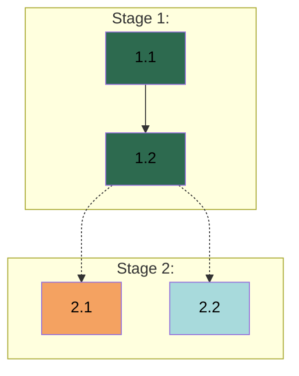

# APM {VERSION} - Work Breakdown Guide

## 1. Overview

**Reading agent:** Planner

Turn approved project context into the Spec, Plan and Rules, in that order. Present concrete proposals with consequential choices and reasons, write each artifact, and obtain its approval before starting the next.

Capture gathered context where execution will use it: Spec for design decisions and constraints, Plan for work structure and Task detail, Rules for broadly applicable execution standards. Explain any consequential omission. Match detail to project complexity.

## 2. Operational Standards

### 2.1 Workflow Context

The Manager reads Spec and Plan, extracts their content into self-contained Task Prompts, and adds runtime workspace/dependency findings. Workers read their prompts and Rules. They do not read coordination documents.

Put project decisions in locatable Spec sections. Task guidance adds domain-specific constraints and implementation context; reference relevant Spec or authoritative User-document sections. The Manager embeds that content when assigning work. Rules must stand alone without references to Spec, Plan or external design documents.

The Manager handles dispatch, version control conventions and holistic verification. Record observations for its judgment in blockquote notes after the Spec/Plan header separator. Spec notes cover environment, working/reference repositories, version control observations, workspace constraints and User preferences. Plan notes cover boundaries, sequencing, critical paths, convergence and Stage verification opportunities. Notes explain observations and reasons, not runtime directives.

### 2.2 Decomposition Principles

- Domains reflect expertise and context. Separate distinct expertise; combine tightly shared context and dependencies. When balanced, prefer separation and account for User preferences.
- Stages are sequential milestones: Stage N+1 follows completion of Stage N. Combine artificial divisions; split unrelated streams or intermediate deliverables that block later work. When balanced, prefer fewer clear milestones. Parallel work belongs in Tasks within a Stage.
- Each Task produces a meaningful, independently validatable deliverable within one Worker's domain. Split cross-domain or unrelated work; combine micro-tasks when separation adds only overhead. Include scoped subagent steps for necessary investigation or research.
- Steps are ordered operations sharing the Task's validation. If a step needs independent validation, split the Task.
- Worker work is executable in the development environment. Identify external actions, credentials or human judgment as explicit User coordination needs.
- Validation gives concrete pass/fail measures for each deliverable. Separate autonomous checks from User-dependent criteria. Keep criteria within the Worker's scope; record holistic verification observations in Plan notes for the Manager.

### 2.3 Spec Standards

The Spec defines what is built and why: choices where alternatives existed, constraints and requirements shaping the project. Its decisions must be implemented by corresponding Plan work. Keep single-scope implementation details in Task guidance and broadly applicable execution patterns in Rules.

Reference authoritative requirement documents with paths/sections. Record the workspace structure, distinguishing working targets from read-only references. Organize decisions so the Manager can find and extract relevant content.

### 2.4 Plan Standards

The Plan defines Stages, Tasks, Workers, dependencies, guidance, steps, outputs and validation. Task definitions must supply enough planning substance for the Manager to construct self-contained assignments.

Keep guidance separate from ordered steps. Reference relevant Spec/source sections for design content and add domain-specific context. Prefer boundaries and ordering that support independent work, same-Worker chains and cross-Worker parallelism where appropriate; the Manager chooses dispatch modes at runtime.

### 2.5 Rules File Standards

Rules describe how to work across all or most Tasks. Output strings, formats, schemas and interface contracts describe what is built and belong in Spec or Task guidance, even when several Workers need them. When uncertain whether a pattern is broadly applicable, keep it in Task guidance.

Write rules conditionally on the work being done. All Workers read the same file. Preserve pre-existing content outside APM_RULES unless the User requests changes; reference relevant existing standards. Keep APM rules self-contained within the Worker's normal context.

## 3. Work Breakdown Procedure

For each document, present the proposal and material choices before writing. Read the target file to preserve its existing state, then write it. After writing, request review and approval, explaining what comes next. Corrections repeat that document's review; do not begin the next until approved.

### 3.1 Spec Proposal

1. Propose the design decisions, constraints, source references and organization needed for the Spec. Explain consequential choices, assumptions and content-placement boundaries. Include workspace structure from Context Gathering.
2. Read `.apm/spec.md` and write the Spec per §4.1. Set `title` to the project name and `modified` to “Spec creation by the Planner.” Keep the Overview to 3–5 sentences covering project type, problem, scope and success criteria.
3. Ask the User to review the artifact. Apply requested corrections and ask again; on approval continue to the Plan.

### 3.2 Plan Proposal

1. Propose Workers and their domains, sequential Stages and deliverables, and the Tasks needed for each. Explain material boundaries, sequencing and dependencies so the User can assess the breakdown.
2. Define each Task's Worker, objective/scope, guidance, output, validation, dependencies and ordered steps. Include needed User involvement. Reference Spec/source sections for design content and add Task-specific implementation context. Identify the deliverable at each dependency boundary.
3. Verify coverage against gathered context and the approved Spec, independent Task validation, reasonable workload distribution and dependency consistency. A producer with a different Worker is a cross-agent dependency. Correct misclassifications and missing work; prepare useful Plan notes.
4. Read `.apm/plan.md` and write it per §4.2, including the Dependency Graph. Match the Spec's `title`; set `modified` to “Plan creation by the Planner.” Bold cross-agent dependencies and use the prescribed graph edges.
5. Ask for review with a brief overview of Workers, Stages, Task counts and dispatch opportunities. Correct and repeat review as needed; on approval continue to Rules.

### 3.3 Rules Proposal

1. Propose execution patterns that apply across all or most work, drawing from the approved documents and gathered context. Keep design/output content in Spec or Task guidance; leave version control conventions to the Manager. Explain consequential inclusions or exclusions and identify existing standards to reference.
2. Read the Rules file or confirm its absence. Write the APM_RULES block per §4.3, preserving outside content. If creating the file, write only the block.
3. Ask the User to review. Apply corrections and request approval again as needed. After approval, continue to `{SKILL_PATH:apm-1-initiate-planner}` §5 Planning Phase Completion.

## 4. Structural Specifications

### 4.1 Spec Format

**Location:** `.apm/spec.md`

**YAML Frontmatter Schema:**
```yaml
---
title: <project name>
modified: <last modification note>
---
```

Below the frontmatter, the document starts with `# APM Spec` followed by two header sections: `## Overview` (3-5 sentences covering project type, core problem, essential scope, and success criteria) and `## Workspace` (project environment from the workspace assessment: directory structure, working repositories, reference repositories, authoritative document locations, and existing Rules file content). A single horizontal rule separates the header from the design decision content below. Use headings to separate content sections.

- *Planner notes:* Placed immediately after the horizontal rule separator, before content sections. Use the format `> **Notes:** <prose or unordered list>`. These cover the project environment the Manager will encounter per §2.1 Workflow Context - version control observations, workspace constraints, and User preferences that affect execution.

**Content structure:** Free-form below the header. Organize into sections that reflect the project's natural structure - its domains, components, boundaries, or technical concerns. Related design decisions share a section; cross-cutting choices get their own. The Spec should read as a coherent description of what is being built and why, shaped by the project's unique requirements.

**Content rules:** Use markdown headings (`##`) to organize decision groups. Each specification must be concrete and actionable. Structure for extraction - the Manager distills relevant content into individual Task Prompts, so decisions should be locatable and separable. Reference existing User documents with paths and specific sections so the Manager can locate source material during Task Assignment. Use tables for enumerated values, mermaid diagrams for relationships, code blocks for schemas, prose for rationale.

### 4.2 Plan Format

**Location:** `.apm/plan.md`

**YAML Frontmatter Schema:**
```yaml
---
title: <project name>
modified: <last modification note>
---
```

Below the frontmatter, the document starts with `# APM Plan` followed by the Plan header: `## Workers` (table with `| Worker | Domain | Description |`), `## Stages` (table with `| Stage | Name | Tasks | Agents |`), and `## Dependency Graph` (mermaid diagram per **Dependency Graph Format** below). A single horizontal rule separates the header from Stage sections below. Use headings to separate Stages and Tasks.

- *Planner notes:* Placed immediately after the horizontal rule separator, before Stage sections. Use the format `> **Notes:** <prose or unordered list>`. These cover what you observed about the work structure per §2.1 Workflow Context - why boundaries exist, natural groupings or sequencing patterns, critical path, convergence points, and Stage boundaries where holistic verification may be valuable.

**Stage Format.** Each Stage in the Plan:

- *Header:* `## Stage N: [Name]`
- *Naming:* Stage names reflect domain(s), objectives, and main deliverables.
- *Contents:* Tasks per **Task Format**, each containing steps per **Step Format**.

**Task Format.** Each Task in the Plan:

*Header:* `### Task <N>.<M>: <Title> - <Domain> Agent`

*Contents:*
```markdown
* **Objective:** [Single-sentence Task goal.]
* **Output:** [Concrete deliverables - files, components, artifacts produced.]
* **Validation:** [Concrete pass/fail criteria. Note where User involvement is needed.]
* **Guidance:** [Technical constraints, approach specifications, references to existing patterns, User collaboration patterns.]
* **Dependencies:** [Prior Task outputs required. Use `Task N.M by <Domain> Agent, ...` format. Bold cross-agent dependencies. Use "None" when no dependencies exist.]

1. [Step description]
2. [Step description]
```

**Step Format:** Each step is a numbered instruction describing a discrete operation. Steps are sequential operations; Guidance is context and constraints that inform how those operations are performed. Keep them separate - steps reference Guidance implicitly, not by embedding it. Include clear, specific instructions that a Worker can execute directly. Reference patterns, files, or prior work when relevant. When investigation, exploration, or research is needed, include a subagent step describing purpose and scope (e.g., "Spawn a debug subagent to isolate the rendering issue" or "Spawn a research subagent to verify the current API authentication patterns").

**Dependency Graph Format:** The Dependency Graph is a mermaid diagram in the Plan header that visualizes Task dependencies, agent assignments, and execution flow. It enables the Manager to identify batch candidates, parallel dispatch opportunities, critical path bottlenecks, and coordination points.

*Graph structure:*


The graph makes dispatch patterns visible to the Manager: same-agent chains indicate batch candidates, independent cross-agent nodes indicate parallel candidates, and dotted edges mark cross-agent coordination points where one Worker's output feeds another's input.

*Node format:* `T<Stage>_<Task>["<Task ID> <Title><br/><i><Agent Name></i>"]`

*Edge rules.* Same-agent dependencies use `-->` (solid). Cross-agent dependencies use `-.->` (dotted). Only direct dependencies - do not draw transitive closure.

*Styling:* Assign each agent a consistent fill color across all its Task nodes. Apply colors via `style T<S>_<T> fill:<color>` statements after all subgraphs, ordered by Worker appearance in the Plan Workers field. Use text color #000 and select fill colors with sufficient contrast for readability.

### 4.3 APM_RULES Block

The namespace block structure for the Rules file:

```text
APM_RULES {

[Project-specific standards below]

} //APM_RULES
```

**Content rules:** Write APM content inside the block; preserve pre-existing content outside it unless the User requests changes. Use markdown headings (`##`) for categories. Each standard must be concrete and actionable. Only universal execution-level patterns - not architecture decisions, Task-specific guidance, or coordination decisions. Reference relevant existing standards outside the block.

---
